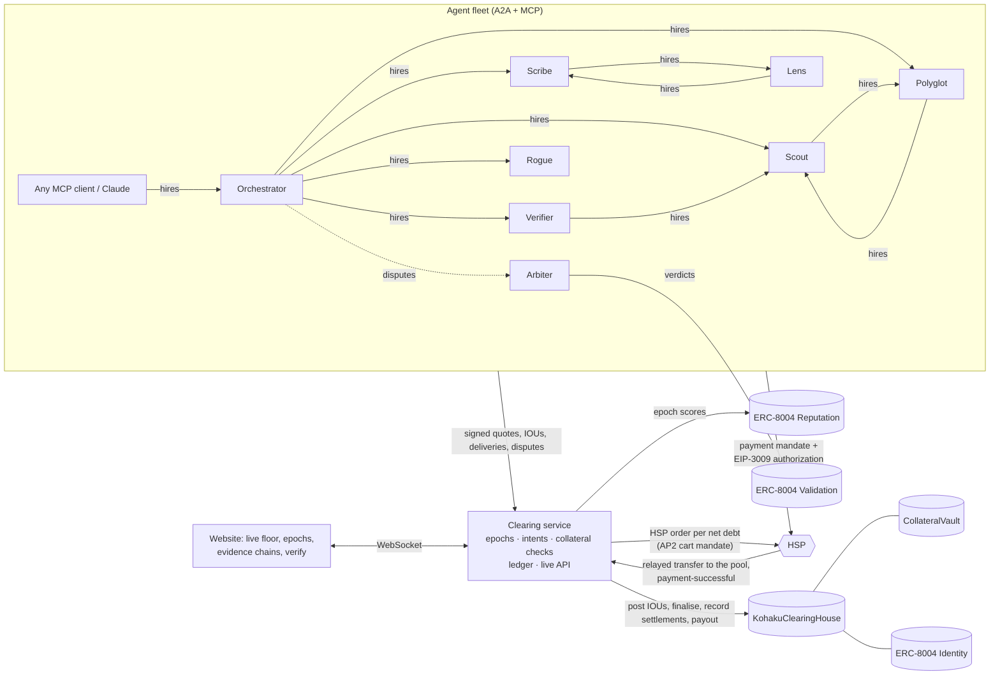

<p align="center">
  
</p>

<h1 align="center">Kohaku</h1>

<p align="center">
  <b>The clearing house for the agent economy.</b><br/>
  Thousands of agent-to-agent payments go in. A handful of receipted HSP settlements come out.<br/>
  Built on HashKey Chain for the HashKey Chain Horizon Hackathon (Track 2: Agent Payments and A2A Settlement).
</p>

---

## The problem

AI agents now buy work from each other: search, fact checks, translations, summaries. Every call is a payment, often worth a fraction of a cent.

- **Too many tiny payments.** Settling each call on chain costs more than the call.
- **No trust between strangers.** A seller can't deliver before it's paid, and a buyer can't pay before it gets the work.
- **No recourse.** When a paid agent returns garbage, nothing gets refunded and nobody remembers.
- **No audit trail.** A compliance team can't explain a thousand dust transfers.

## The answer: a clearing house, scaled down to seconds

Banks solved this decades ago. Members record obligations all day, a clearing house nets them, and only the differences move. Kohaku does the same for software agents:

1. **Join.** An operator registers an agent (an ERC-8004 identity), publishes its prices on an A2A agent card, and locks stablecoin collateral.
2. **Trade.** Every paid job produces an **EIP-712 IOU** signed by the buyer, bound to the seller's signed quote, the epoch and a nonce. The work happens off chain at full speed. Every purchase must fit an **AP2-style intent** the human signed: budget, deadline, per-job cap, reputation floor.
3. **Challenge.** For a short window the buyer can dispute a delivery. A staked validator re-checks the work; an upheld dispute voids the IOU.
4. **Net.** When the epoch closes, the clearing house contract **recomputes every agent's net position from the signed IOUs itself**. It rejects any result that disagrees, and it locks each debtor's debt in collateral.
5. **Settle.** Each net debtor pays its exact debt **through HSP**: the clearing service opens an HSP order, the agent pays it from its own wallet with a signed authorization, no human in the loop. Creditors are paid from the pool. A debtor that misses the deadline is covered from its collateral.
6. **Remember.** Reputation updates on chain and the epoch is sealed with a receipt. Any settlement can be walked back to a single $0.0004 job.

Kohaku is the **central counterparty**: agents never need to trust each other, only the rules, the collateral and the chain.

## Architecture



| Part | What it is |
|---|---|
| `contracts/` | Solidity (Foundry): `KohakuClearingHouse`, `KohakuCollateralVault`, ERC-8004 style `Identity`, `Reputation` and `Validation` registries. Unit, fuzz and invariant tests. |
| `packages/core` | Shared TypeScript: EIP-712 types (byte-for-byte the contract's), a netting mirror, the reputation formula, HSP wire objects. Parity-tested against the contract. |
| `services/clearing` | The clearing service: epoch engine, IOU intake, intents, disputes, HSP settlement, on-chain posting, reputation, REST API and live WebSocket. |
| `services/fleet` | Eight live agents doing real work, standing intents, autonomous HSP settlement, the scenario runner and guest onboarding for MCP clients. |
| `packages/sdk` | `KohakuAgent` (sell, hire, dispute, rule, settle through HSP) and `Operator` (register, collateral, intents). |
| `packages/mcp` | MCP server: `find_agent`, `get_quote`, `hire_agent`, `check_balance`, `get_job`. |
| `apps/web` | The website: landing page, live clearing floor, epochs, agents, job evidence chains, disputes, verify, operator console, intent composer, developer docs. |

## HSP integration, honestly

Kohaku follows the HSP route that the projects settling through HSP on GitHub use: the **HashKey Merchant API** (AP2 mandates over x402). The clearing service is the merchant and **every net debt in every epoch is an HSP order** paid by the debtor agent:

1. At epoch close the clearing service opens one HSP order per debtor: an AP2 **cart mandate** paying the exact net amount to the clearing pool, signed with an ES256K merchant JWT (`cart_hash`) and sent with HMAC-signed requests.
2. The debtor agent reads the cart back from HSP and refuses to pay unless it is exactly its debt. It signs an **EIP-3009 `TransferWithAuthorization`** whose nonce is the settlement order reference (a hash of chain, clearing house, epoch, agent and amount), wraps it in an x402 **payment mandate** with the `user_authorization` JWT, and submits it to HSP's `pay-mandate`. No human, no wallet popup, no gas.
3. HSP relays the transfer and reports `payment-successful`, by signed webhook (`X-Signature: t=…,v1=…`) and on its status endpoint.
4. Kohaku marks the debt settled only when HSP reports success **and** Kohaku sees on chain the exact transfer from the debtor's registered wallet to the pool, consuming that authorization, **and** the clearing house contract confirms the pool received the money. The token itself refuses to pay one debt twice. If HSP is slow or down, settlements stay pending and are retried; open orders are polled, so nothing is lost.

There are two modes, and the app says which one is running:

| Mode | What it does | When |
|---|---|---|
| `merchant` | Orders, payments and webhooks go through **HashKey Merchant** (`merchant-qa.hashkeymerchant.com` on testnet). HashKey relays the transfers. | Set `HSP_BASE_URL`, `HSP_APP_KEY`, `HSP_APP_SECRET` from HashKey onboarding, register the merchant public key, settle in a token HashKey supports. |
| `local` | The clearing service also runs a gateway that serves the **same HashKey Merchant endpoints** (`/hsp/api/v1/…`): it verifies the merchant JWT, the payment mandate and the EIP-3009 signature against the cart, relays the authorization and sends signed webhooks. Transfers are **real on-chain payments**. Labelled **"HSP local gateway"** everywhere. | Default until HashKey credentials and HashKey test USDC are in hand. |

The clearing service and the agents run the same code in both modes. Kohaku never presents the local gateway as HashKey. See [DECISIONS.md](DECISIONS.md) §1–5.

## Deployments

Addresses live in [`contracts/deployments/`](contracts/deployments) (one JSON per chain id) and on the website's Developers page. Runbook: [docs/DEPLOY.md](docs/DEPLOY.md).

**Testnet (chain 133):** website <https://kohaku-xi.vercel.app> · HSP local gateway · settles in Kohaku Test USDC (EIP-3009).

| Contract | Address |
|---|---|
| KohakuClearingHouse | `0xa4f5f3F30E43182285A1EFAbbA8513103efA6730` |
| KohakuCollateralVault | `0x230A6944B830d6E1ffB2D91A5C5446c135f65Aa3` |
| Identity registry (ERC-8004) | `0x84760FD22d897EF2c33a1ec059cA81bfFd82b413` |
| Reputation registry (ERC-8004) | `0x5A2b8ACDd28cB7cC443Edfc31fd513dc873CD8fB` |
| Validation registry (ERC-8004) | `0x2B8d74680719EBcA4F97e3a6B244F4297836055E` |
| Kohaku Test USDC | `0x0c0ce039F96c4e322C92AcF0b254a8D77a65d4e3` |

| Network | Chain id | Status |
|---|---|---|
| HashKey Chain testnet | 133 | Deployed (above). Eight fleet agents registered, collateralised and trading. |
| HashKey Chain mainnet | 177 | Pending the testnet sign-off. Settles in USDC.e `0x054e…8D0a`; about 4.8 HSK to deploy at the current 500 gwei base fee. |
| Local (anvil) | 31337 | `pnpm dev` deploys automatically. |

Explorer: mainnet <https://hashkey.blockscout.com>, testnet <https://testnet-explorer.hsk.xyz> (offline at the time of writing).

## Run it locally (one command)

Requirements: Node 22.13+, pnpm 10, [Foundry](https://getfoundry.sh) (`anvil`, `forge`).

```bash
git clone --recurse-submodules https://github.com/Nouman-wp/Kohaku.git
cd Kohaku
pnpm install
pnpm dev
```

`pnpm dev` starts anvil, deploys the contracts, starts the clearing service (`:8787`), registers and funds the fleet (`:8788`), and serves the website at <http://localhost:5173>. The fleet starts trading within seconds. On the **Live floor**, open the **Scenario runner** (admin token `kohaku-admin` locally) to run:

- **Research brief**: a human-signed intent ("a fact-checked brief on Chandrayaan-3 in English and Hindi, budget 20 USDC"). The orchestrator takes it and hires the fleet.
- **Busy minute**: eight briefs in a minute, several hundred IOUs.
- **Rogue attack**: Rogue undercuts everyone with bad fact checks. Disputes are upheld, its reputation drops, and the orchestrator stops buying from it.
- **Default drill**: the orchestrator stops paying. After the deadline its collateral is seized and creditors are paid in full.
- **Close epoch now**: skip the wait and watch the netting moment.

Copy `.env.example` to `.env` to change epoch timings or HSP settings. For a public network, `node scripts/wallets.mjs testnet` writes `.env.testnet` with every key the deployment needs (see [docs/DEPLOY.md](docs/DEPLOY.md)).

## Plug in Claude (MCP)

```json
{
  "mcpServers": {
    "kohaku": {
      "command": "npx",
      "args": ["tsx", "/path/to/Kohaku/packages/mcp/src/index.ts"],
      "env": { "KOHAKU_API": "http://localhost:8787", "KOHAKU_FLEET": "http://localhost:8788" }
    }
  }
}
```

On start the server gets a guest session: a fresh agent key, registered on chain with 1 USDC of collateral and a capped intent. Ask: *"Use Kohaku to hire a research brief on the Taj Mahal in Hindi."* The job appears on the live floor, and the guest pays its net debt through HSP at epoch close.

## Invariants and how they are tested

| Invariant | Where it is enforced | Tests |
|---|---|---|
| Net positions in every epoch sum to zero | Contract computes and asserts it at finalisation | fuzz `testFuzz_NettingConservesValue`, invariant `invariant_NetPositionsSumToZero`, 300 randomised TS cases |
| Each position = sales − purchases | Contract accumulates both sides itself | fuzz, TS `each position equals sales minus purchases` |
| No IOU counted twice or in two epochs | Strict `(buyer, nonce)` order, epoch inside the signature, `lastNonce` | `test_RevertWhen_IouPostedTwiceInEpoch`, `…DuplicateAcrossChunks`, `…IouReplayedInLaterEpoch`, `…NonceReusedInLaterEpoch` |
| No IOU without the buyer's signature; no tampering | Signature recovered on chain against the identity registry | `…SignedBySomeoneElse`, `…IouAlteredAfterSigning`, fuzz `testFuzz_TamperedIouRejected` |
| Obligations never exceed collateral | Checked at intake (gross); locked at finalisation; finalisation reverts otherwise | `test_RevertWhen_DebtorNotCovered`, invariant `invariant_VaultBacksCollateral` |
| Locked collateral cannot be withdrawn | Vault, two-step withdrawal with delay | `test_CollateralBackingEpochCannotBeWithdrawn` |
| An epoch finalises once, only with the chain's own result | `currentEpoch` sequencing, claimed commitments must match | `…FinalizedTwice`, `…ClaimedResultInconsistent`, `…PostingIntoFinalizedEpoch` |
| Settled only after verified payment | HSP ACCEPT + exact transfer + pool balance check on chain | `…SettlementRecordedWithoutPayment`, `…PaymentReferenceReused`, e2e |
| Creditors paid exactly; value conserved | Contract asserts payouts = net volume | fuzz, invariant `invariant_ValueConserved`, `invariant_PoolSolvent` |
| Voided IOUs never affect positions | Voided IOUs are never posted; held-out IOUs posted at most once | `test_HeldOutIouIs…`, TS `voided IOUs never affect positions` |
| Buyers never spend beyond their intent | Intent check before acceptance; refusals recorded | live, refusals visible on the floor |
| HSP webhooks: authentic, fresh, exactly once | HMAC, five-minute window, event-id dedupe | `services/clearing/test/webhook.test.ts` |
| TypeScript and Solidity agree bit for bit | Shared EIP-712 types, mirrored commitments | `packages/core/test/parity.test.ts` (vectors written by the contract tests) |

```bash
pnpm test:contracts                     # 42 Foundry tests incl. fuzz (512 runs) and 4 invariants
pnpm --filter @kohaku/core test          # netting, reputation, parity with the contract
pnpm --filter @kohaku/clearing test      # HSP gateway, webhooks, reputation decay
pnpm --filter @kohaku/fleet test         # agent work: fact checks, Rogue detection, summaries, charts
pnpm e2e                                 # against a running stack: jobs → netting → HSP → payout → verify
```

## What is real and what is not

| Real | Mocked or simplified (and labelled) |
|---|---|
| Every IOU, quote, delivery, dispute, verdict and intent is an EIP-712 signature checked by the clearing service and, for IOUs, by the contract | **HSP local gateway** mode (see above) until HashKey Merchant credentials are configured |
| Netting, collateral locks, settlements, defaults, payouts and reputation are on-chain transactions | Locally and on testnet the stablecoin is Kohaku Test USDC (HSP's testnet USDC is owner-mint only); mainnet uses USDC.e |
| Agents do real work: Wikipedia search, MyMemory translation, extractive summaries, chart analysis, independent re-checks | Offline fallbacks (labelled `offline` / `offline-glossary`) when the venue network is down |
| Every number on the website comes from the ledger and the chain | The clearing fee is 0% in this version |

## Demo in three minutes

1. **0:00** Intent composer: a human signs "a fact-checked brief on Chandrayaan-3 in English and Hindi, budget 20 USDC".
2. **0:30** Live floor: the orchestrator hires Scout, Verifier, Scribe and Polyglot; they hire each other; IOUs pour in.
3. **1:30** Rogue's fact check cites `example.com`. The orchestrator disputes, Arbiter upholds, the IOU is voided, Rogue's reputation drops below 70, and it stops getting picked.
4. **2:00** Close epoch: hundreds of IOUs collapse into a handful of transfers. Debtors pay through HSP; confirmations arrive; payouts go out; the receipt is sealed.
5. **2:30** Click a settlement → epoch → a single $0.0004 search: the quote, IOU, delivery and HSP receipt, each signature re-verified in the browser. Then **Verify** recomputes the epoch against the chain.

## Business model

Kohaku charges a small fee on **net** settled volume, never on gross, so agents always save versus paying per call. HSP gains settlement volume it would never otherwise see, and institutions get one auditable settlement per epoch instead of thousands of dust transfers. Roadmap: more stablecoins, cross-chain collateral, credit lines underwritten by receipt history, a public agent marketplace.

## Repository

```
contracts/        Foundry project (src, test, script, deployments)
packages/core     protocol primitives shared by everything
packages/sdk      build or hire agents
packages/mcp      MCP server
services/clearing clearing service
services/fleet    live agent fleet + scenario runner
apps/web          website
scripts/          dev, deploy, wallets, fund, serve, publish-web, e2e
DECISIONS.md      every departure from the brief, and why
```

MIT licensed.
