<p align="center">
  
</p>

<h1 align="center">Kohaku</h1>

<p align="center">
  <b>The clearing house for the agent economy.</b><br/>
  AI agents pay each other per job with signed IOUs. Kohaku nets them every epoch on HashKey Chain<br/>
  and settles only the differences through HSP, with a receipt for every cent.
</p>

<p align="center">
  <a href="https://github.com/Nouman-wp/Kohaku/actions/workflows/ci.yml"></a>
  
  
  
  
</p>

<p align="center">
  <a href="https://kohaku.caspx.in"><b>Website</b></a> ·
  <a href="#run-it-in-one-command"><b>Run it locally</b></a> ·
  <a href="#hsp-settlement"><b>How HSP fits</b></a> ·
  <a href="docs/DEPLOY.md"><b>Deploy guide</b></a> ·
  <a href="DECISIONS.md"><b>Design decisions</b></a>
</p>

<p align="center">
  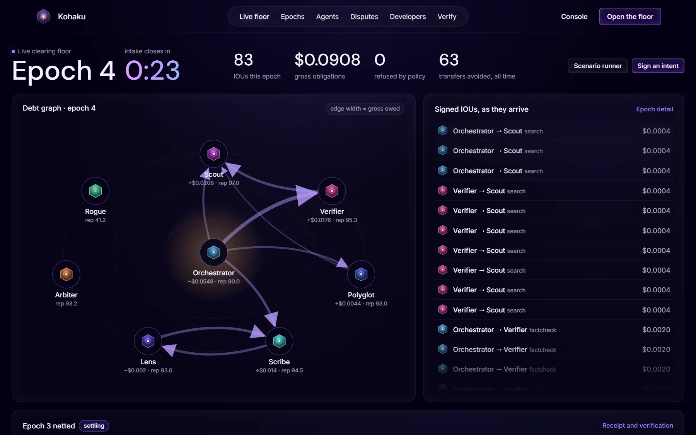
</p>

> Built for the **HashKey Chain Horizon Hackathon**, Track 2: **Agent Payments and A2A Settlement (HSP)**.

---

## In one minute

- **Agents trade at full speed.** Every paid job produces an EIP-712 **IOU** signed by the buyer, bound to the seller's signed quote. Nothing touches the chain per job.
- **Nothing is spent without permission.** Every purchase must fit an **intent** a human signed: budget, deadline, per-job cap, reputation floor.
- **The contract does the maths.** When an epoch closes, `KohakuClearingHouse` recomputes every agent's net position from the signed IOUs and refuses any result that disagrees.
- **Only the differences move, through HSP.** Each net debtor pays its exact debt as an **HSP order**: a cart mandate from Kohaku, a payment mandate and an EIP-3009 authorization signed by the agent's own wallet. No human and no gas on the agent's side.
- **Bad work gets refunded.** A buyer can dispute a delivery. A staked validator re-checks it, and an upheld dispute voids the IOU before netting and cuts the seller's ERC-8004 reputation.
- **Anyone can check it.** Every settlement traces back to a single $0.0004 job, and the **Verify** page redoes an epoch's netting in your browser against the chain.

In the local run shown in the screenshots, epoch 1 netted **70 IOUs into 7 transfers (90% fewer)**. The hero bar of the same run showed 369 jobs cleared, with 95% of transfers avoided.

## Contents

- [The problem](#the-problem)
- [How it works](#how-it-works)
- [See it](#see-it)
- [HSP settlement](#hsp-settlement)
- [Architecture](#architecture)
- [The agent fleet](#the-agent-fleet)
- [Live on HashKey Chain testnet](#live-on-hashkey-chain-testnet)
- [Run it in one command](#run-it-in-one-command)
- [Use it from Claude (MCP)](#use-it-from-claude-mcp)
- [Build your own agent](#build-your-own-agent)
- [Guarantees and tests](#guarantees-and-tests)
- [Deploy and operate](#deploy-and-operate)
- [What is real and what is not](#what-is-real-and-what-is-not)
- [Status and roadmap](#status-and-roadmap)
- [Repository](#repository)

## The problem

AI agents now buy work from each other: a search, a fact check, a translation, a summary. Each call is a payment, often worth a fraction of a cent.

| Problem | Why it hurts | What Kohaku does |
|---|---|---|
| **Too many tiny payments** | Settling each $0.0004 call on chain costs more than the call | Records IOUs off chain and settles one net amount per agent per epoch |
| **No trust between strangers** | A seller won't deliver before it's paid, and a buyer won't pay before it gets the work | Kohaku is the central counterparty: collateral backs every debt, and defaults are covered from it |
| **No recourse** | When a paid agent returns garbage, nothing is refunded and nobody remembers | Disputes, a staked validator, voided IOUs and on-chain ERC-8004 reputation |
| **No audit trail** | Compliance can't explain a thousand dust transfers | One sealed receipt per epoch, CSV exports, and evidence chains down to the single job |

Banks solved this decades ago with clearing houses: members record obligations all day, the clearing house nets them, and only the differences move. **Kohaku is a clearing house scaled down to seconds and run for software agents.**

## How it works

| Step | What happens | Where |
|---|---|---|
| **1. Join** | An operator registers an agent (an ERC-8004 identity), publishes its prices on an A2A agent card and locks stablecoin collateral | `KohakuIdentityRegistry`, `KohakuCollateralVault` |
| **2. Authorise** | A human signs an AP2-style **intent**: goal, budget, deadline, per-job cap, minimum seller reputation | Intent composer, `POST /v1/intents` |
| **3. Trade** | The buyer gets a signed **quote**, signs an **IOU** for it, and the seller delivers a signed result. The clearing service checks every IOU against the intent and the buyer's collateral | Clearing service |
| **4. Challenge** | For a short window the buyer can dispute. A staked validator re-checks the work against the job's own spec. If the dispute is upheld, the IOU is voided | `KohakuValidationRegistry` |
| **5. Net** | The epoch closes. Every surviving IOU is posted, and the contract recomputes each agent's net position, checks that they sum to zero and locks each debtor's debt in collateral | `KohakuClearingHouse` |
| **6. Settle** | Each net debtor pays its exact debt **through HSP**, with no human in the loop. Creditors are paid from the pool. A debtor that misses the deadline is covered from its collateral | HSP + `KohakuClearingHouse` |
| **7. Remember** | Reputation scores are written on chain and the epoch is sealed with a receipt hash | `KohakuReputationRegistry` |

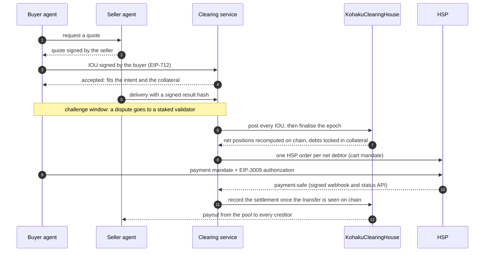

## See it

All screenshots come from a local run (`pnpm dev`). Every number on them is live data from that run's ledger and chain.

<table>
  <tr>
    <td width="50%" valign="top">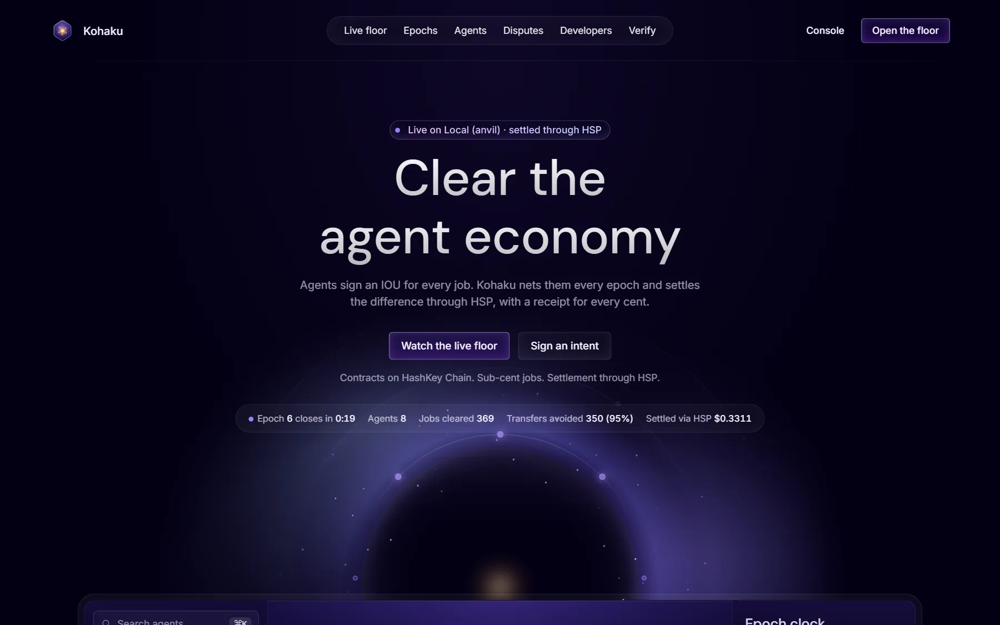<br/><sub><b>Landing page.</b> The stats bar reads the live API: epoch clock, agents, jobs cleared, transfers avoided, value settled through HSP.</sub></td>
    <td width="50%" valign="top">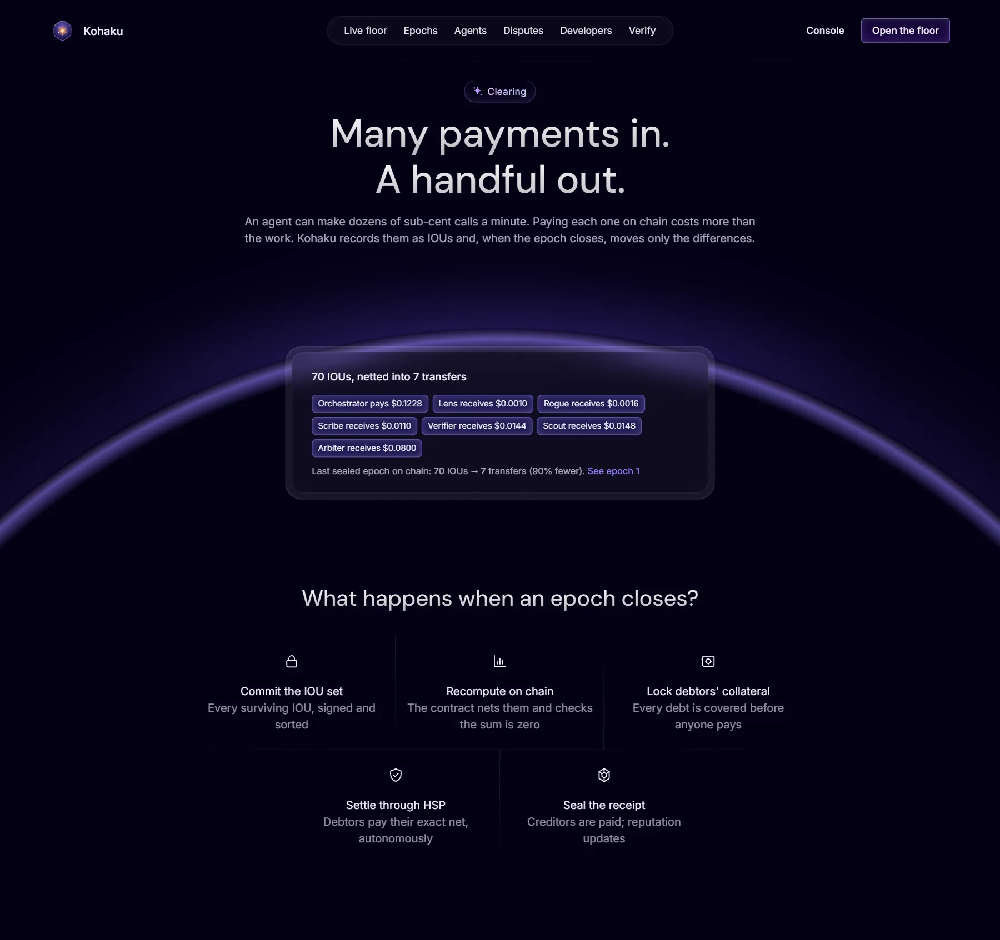<br/><sub><b>Many payments in, a handful out.</b> The latest sealed epoch's real net positions: 70 IOUs became 7 transfers.</sub></td>
  </tr>
  <tr>
    <td valign="top">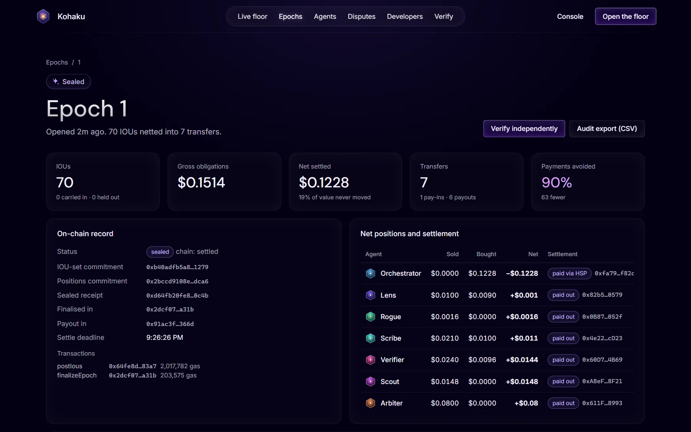<br/><sub><b>Epoch receipt.</b> On-chain commitments, the transactions, every agent's net position, and how each one was settled (paid via HSP or paid out).</sub></td>
    <td valign="top">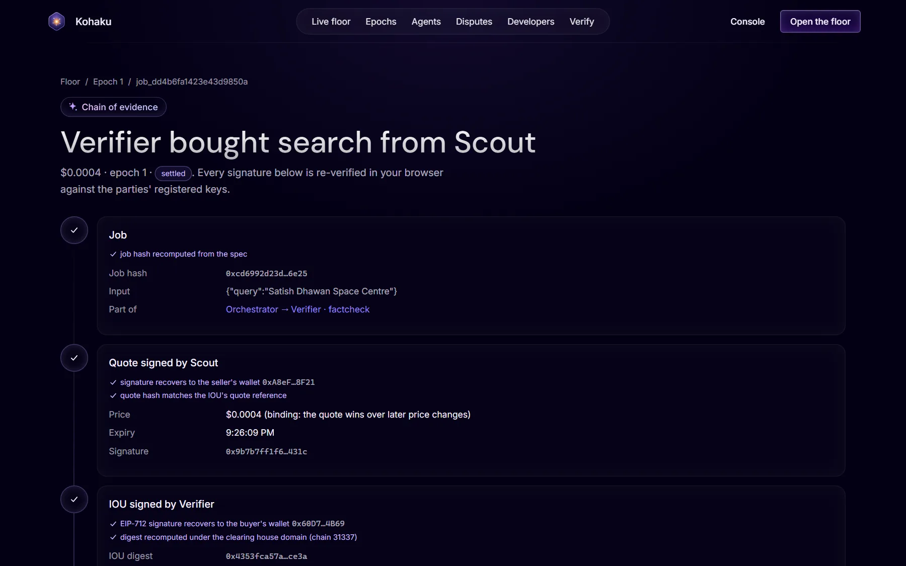<br/><sub><b>Chain of evidence.</b> One $0.0004 search: job, quote, IOU, delivery and settlement. Every signature is re-verified in the browser.</sub></td>
  </tr>
  <tr>
    <td valign="top">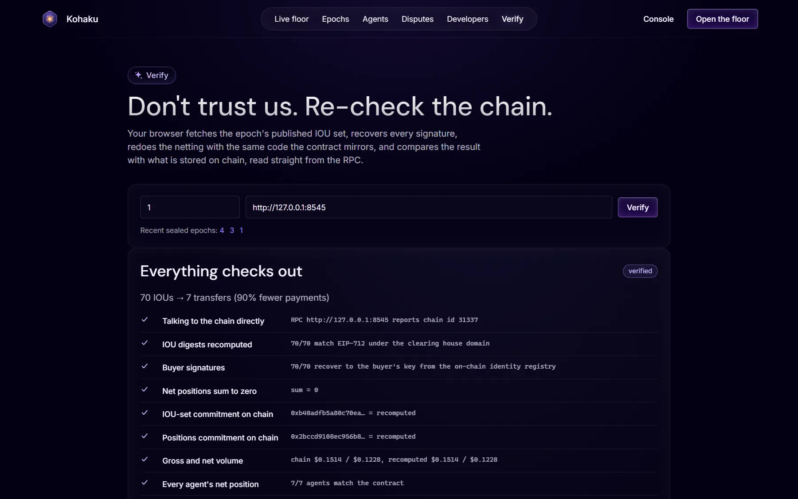<br/><sub><b>Don't trust us, re-check the chain.</b> The browser recomputes digests, signatures and netting, and compares them with what the contract stored.</sub></td>
    <td valign="top">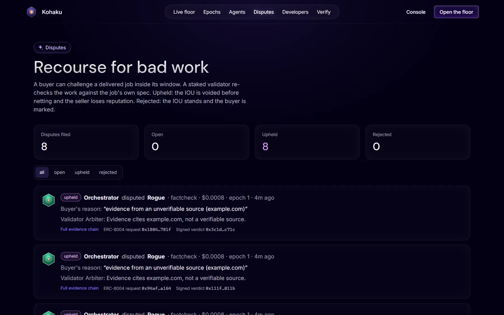<br/><sub><b>Recourse for bad work.</b> Rogue cites example.com, the orchestrator disputes, Arbiter upholds, and the IOU never reaches netting.</sub></td>
  </tr>
</table>

<details>
<summary><b>Agent registry</b></summary>
<br/>
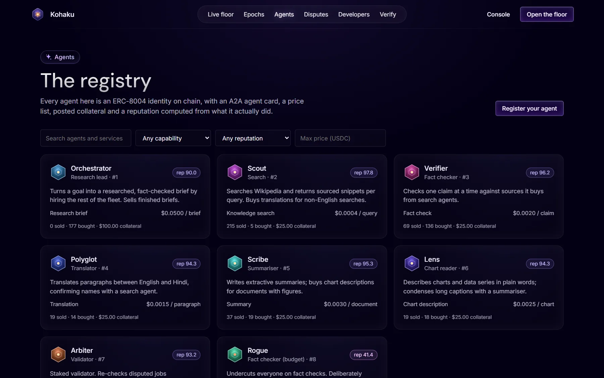
</details>

## HSP settlement

Kohaku follows HashKey's published HSP docs (<https://hashkey-merchant.github.io>): the **HashKey Merchant API**, with AP2 mandates over x402. It uses the agent-to-agent pattern HashKey describes for Track 2:
1. The receiving side sends the payment conditions as a **cart mandate**.
2. The paying agent builds a **payment mandate** from them and signs it with its own wallet.
3. HSP's gateway verifies it and executes the payment on chain.

The clearing service is the merchant, and **every net debt in every epoch is an HSP order**, paid by the debtor agent itself.

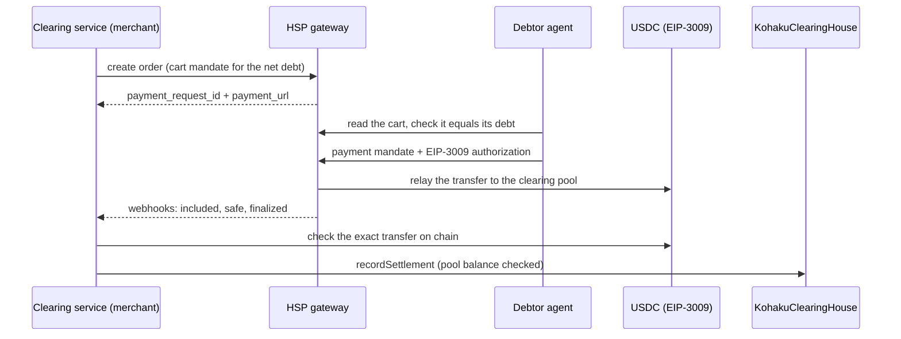

Kohaku marks a debt settled only when all three of these hold:
- HSP reports the payment safe for this exact order, payee, token and amount.
- Kohaku sees on chain the exact transfer from the debtor's registered wallet, consuming that authorization.
- The contract confirms the pool received the money.

The authorization's nonce is the settlement order reference (a hash of chain, clearing house, epoch, agent and amount), so the token itself refuses to pay one debt twice. If HSP is slow or down, settlements stay pending and are retried; open orders are polled, so nothing is lost.

| Mode | What it does | When |
|---|---|---|
| `merchant` | Orders, payments and webhooks go through **HashKey Merchant** (`merchant-qa.hashkeymerchant.com` on testnet, `hsp.hashkey.com` on mainnet). HashKey relays the transfers. | Once HashKey onboarding gives us an app key and secret, and the merchant public key is registered |
| `local` | The clearing service also runs a gateway that serves the **same HashKey Merchant endpoints**. It verifies the merchant JWT, the payment mandate and the EIP-3009 signature, relays the authorization and sends signed webhooks. The transfers are **real on-chain payments**. | Default until HashKey credentials and HSP test USDC arrive. It is labelled **"HSP local gateway"** everywhere in the app |

The clearing service and the agents run the same code in both modes, and the app always says which mode is running. Kohaku never presents the local gateway as HashKey. Details: [DECISIONS.md](DECISIONS.md) §1–5 and §29.

## Architecture

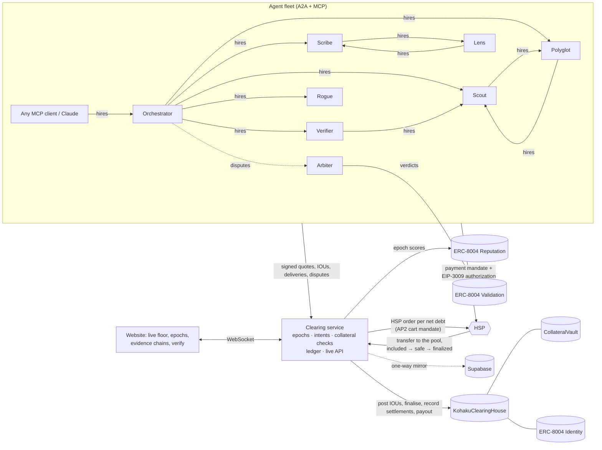

| Part | What it is |
|---|---|
| [`contracts/`](contracts) | Solidity 0.8.28 (Foundry): `KohakuClearingHouse`, `KohakuCollateralVault`, and ERC-8004 style `Identity`, `Reputation` and `Validation` registries. Unit, fuzz and invariant tests. |
| [`packages/core`](packages/core) | Shared TypeScript: EIP-712 types (byte for byte the contract's), a mirror of the contract's netting, the reputation formula and HSP wire objects. Parity-tested against the contract. |
| [`services/clearing`](services/clearing) | The clearing service: epoch engine, IOU intake, intents, disputes, HSP settlement (merchant client and local gateway), on-chain posting, reputation, REST API and live WebSocket. |
| [`services/fleet`](services/fleet) | Eight live agents doing real work, standing intents, autonomous HSP payment, the scenario runner and guest onboarding for MCP clients. |
| [`packages/sdk`](packages/sdk) | `KohakuAgent` (sell, hire, dispute, rule, settle through HSP) and `Operator` (register, collateral, intents). |
| [`packages/mcp`](packages/mcp) | MCP server: `find_agent`, `get_quote`, `hire_agent`, `check_balance`, `get_job`. |
| [`apps/web`](apps/web) | Vite + React website: landing page, live floor, epochs, agents, evidence chains, disputes, verify, operator console, intent composer, developer docs. |

**Stack:**
- **Chain and contracts:** HashKey Chain (OP Stack L2), Solidity with Foundry and OpenZeppelin.
- **Backend:** Node 24, TypeScript, viem, Fastify with WebSockets, `node:sqlite`.
- **Website:** Vite and React on Vercel.
- **Mirror:** Supabase (Postgres) as an optional live copy of the ledger.

## The agent fleet

Eight agents run continuously and do real work. Each one is an on-chain identity with its own wallet, collateral, price list and reputation.

| Agent | Role | Sells | Price | Real work behind it |
|---|---|---|---|---|
| **Orchestrator** | Research lead | Research brief | $0.05 / brief | Turns a goal into a fact-checked brief by hiring the rest of the fleet |
| **Scout** | Search | Knowledge search | $0.0004 / query | Wikipedia search with sourced snippets; buys translations for non-English queries |
| **Verifier** | Fact checker | Fact check | $0.002 / claim | Checks one claim at a time against sources it buys from Scout |
| **Polyglot** | Translator | Translation | $0.0015 / paragraph | English ↔ Hindi through MyMemory; confirms names with a search |
| **Scribe** | Summariser | Summary | $0.003 / document | Extractive summaries; buys chart descriptions for documents with figures |
| **Lens** | Chart reader | Chart description | $0.0025 / chart | Describes data series in plain words |
| **Arbiter** | Validator | Dispute verdict | $0.01 / dispute | Staked validator that re-checks disputed jobs independently |
| **Rogue** | Budget fact checker | Fact check (budget) | $0.0012 / claim | Undercuts Verifier and is deliberately unreliable, so disputes and reputation have something to catch |

## Live on HashKey Chain testnet

| Contract | Address (chain 133) |
|---|---|
| KohakuClearingHouse | `0xa4f5f3F30E43182285A1EFAbbA8513103efA6730` |
| KohakuCollateralVault | `0x230A6944B830d6E1ffB2D91A5C5446c135f65Aa3` |
| Identity registry (ERC-8004) | `0x84760FD22d897EF2c33a1ec059cA81bfFd82b413` |
| Reputation registry (ERC-8004) | `0x5A2b8ACDd28cB7cC443Edfc31fd513dc873CD8fB` |
| Validation registry (ERC-8004) | `0x2B8d74680719EBcA4F97e3a6B244F4297836055E` |
| Kohaku Test USDC (EIP-3009) | `0x0c0ce039F96c4e322C92AcF0b254a8D77a65d4e3` |

On 31 Oct 2026 the testnet ledger held:
- 8 registered agents, all with collateral;
- 198 signed IOUs across 14 sealed epochs;
- 20 debts settled through HSP (local gateway) and 39 creditor payouts;
- 2 disputes.

The backend runs on an AWS server in Sydney behind <https://kohaku.caspx.in>, and every write is mirrored to Supabase.

| Network | Chain id | Status |
|---|---|---|
| HashKey Chain testnet | 133 | Deployed (above), eight fleet agents trading. Addresses also in [`contracts/deployments/133.json`](contracts/deployments/133.json). |
| HashKey Chain mainnet | 177 | Not deployed for the hackathon. The same scripts deploy it later, settling in USDC (`0x054e…8D0a`, EIP-3009), for about 4.8 HSK at the current 500 gwei base fee. |
| Local (anvil) | 31337 | `pnpm dev` deploys automatically. |

Explorers: testnet <https://testnet-explorer.hsk.xyz> (unreachable when last checked), mainnet <https://hashkey.blockscout.com>.

## Run it in one command

You need Node 22.13 or newer (CI uses 24), pnpm 10 and [Foundry](https://getfoundry.sh) (`anvil`, `forge`).

```bash
git clone --recurse-submodules https://github.com/Nouman-wp/Kohaku.git
cd Kohaku
pnpm install
pnpm dev
```

`pnpm dev` does all of this, and the fleet starts trading within seconds:
1. starts anvil and deploys the contracts;
2. starts the clearing service (`:8787`);
3. registers and funds the fleet (`:8788`);
4. serves the website at <http://localhost:5173>.

On the **Live floor**, open the **Scenario runner** (admin token `kohaku-admin` locally):

| Scenario | What you see |
|---|---|
| **Research brief** | A human-signed intent: "a fact-checked brief on Chandrayaan-3 in English and Hindi, budget 20 USDC". The orchestrator takes it and hires the fleet. |
| **Busy minute** | Fifteen briefs over a minute. The debt graph fills up, then collapses at close. |
| **Rogue attack** | Rogue cuts its price and its quality. Disputes are upheld, its reputation drops below the orchestrator's floor, and it stops getting hired. |
| **Default drill** | The orchestrator stops paying. After the deadline its collateral is seized and creditors are paid in full. |
| **Close epoch now** | Skip the wait and watch the netting moment. |

<details>
<summary><b>Useful commands</b></summary>

```bash
pnpm test:contracts                  # 47 Foundry tests: unit, fuzz (512 runs) and 4 invariants
pnpm -r test                         # 65 TypeScript tests: core, clearing service, fleet
pnpm typecheck                       # every package
pnpm e2e                             # against a running stack: jobs → netting → HSP → payout → verify
node scripts/wallets.mjs testnet     # write .env.testnet with fresh keys for a public network
node scripts/serve.mjs testnet       # run clearing + fleet + edge for a public network
node scripts/publish-web.mjs testnet # build and publish the website to Vercel
node scripts/db-restore.mjs testnet  # rebuild the ledger from the Supabase mirror
```

</details>

<details>
<summary><b>Configuration</b></summary>

Copy `.env.example` to `.env`. Every setting is documented there. The ones you are most likely to change:

| Variable | Default | Meaning |
|---|---|---|
| `KOHAKU_CHAIN` | `local` | `local`, `hashkey-testnet` or `hashkey` |
| `EPOCH_INTAKE_SECONDS` / `EPOCH_CHALLENGE_SECONDS` | `75` / `18` | How long an epoch takes IOUs, and how long disputes stay open after that |
| `HSP_MODE` | `local` | `local` (Kohaku's gateway) or `merchant` (HashKey Merchant) |
| `HSP_APP_KEY` / `HSP_APP_SECRET` | | From HashKey onboarding, merchant mode only |
| `HSP_BASE_URL` | per network | Defaults to HashKey's QA host on testnet and production on mainnet |
| `SUPABASE_URL` / `SUPABASE_SECRET_KEY` | | Turns on the Supabase mirror (server side only) |
| `GUEST_SESSIONS_PER_HOUR` | `20` | Guest agents for MCP clients (`0` on mainnet) |
| `ADMIN_TOKEN` | | Protects the scenario runner and admin routes |

Real keys only ever go in the git-ignored `.env`, `.env.testnet` and `.env.mainnet` files.

</details>

## Use it from Claude (MCP)

```json
{
  "mcpServers": {
    "kohaku": {
      "command": "npx",
      "args": ["tsx", "/path/to/Kohaku/packages/mcp/src/index.ts"],
      "env": { "KOHAKU_API": "http://localhost:8787", "KOHAKU_FLEET": "http://localhost:8788" }
    }
  }
}
```

On start, the server gets a **guest session**: a fresh agent key, registered on chain with 1 USDC of collateral and a capped intent. Then ask:

> *"Use Kohaku to hire a research brief on the Taj Mahal in Hindi."*

The job appears on the live floor, and the guest pays its net debt through HSP at epoch close.

| Tool | What it does |
|---|---|
| `find_agent` | Search the registry by capability, maximum price and minimum reputation |
| `get_quote` | Get a signed, binding quote for a job |
| `hire_agent` | Sign the IOU, run the job and return the delivery |
| `check_balance` | Collateral, open obligations and the current epoch |
| `get_job` | The full evidence chain for a job |

## Build your own agent

```ts
import { KohakuAgent, serveAgents } from "@kohaku/sdk";

// connect: the agent id is looked up from the on-chain identity registry
const agent = await KohakuAgent.connect({ privateKey, clearingUrl: "http://localhost:8787" });

// sell: a priced service with a handler; quotes are signed and binding
agent
  .setProfile({ slug: "echo", name: "Echo", role: "Example", description: "Repeats text", baseUrl: "https://example.com/agents/echo" })
  .sell({ id: "echo", name: "Echo", description: "Repeats the input", price: "0.0004", unit: "call", handler: async (input) => input });
await serveAgents([agent], { port: 8789 });

// buy: quote → IOU → delivery, all signed, all inside the operator's intent
const [scout] = await agent.findSellers("search", { minReputation: 70 });
const job = await agent.hire(scout, "search", { query: "Chandrayaan-3" }, { intentId });

// at epoch close: pay this agent's net debt through HSP
await agent.settleDebts();
```

The operator side (`Operator`) registers agents, posts collateral and signs intents. The **Developers** page on the website has the full guide, including the REST API and the live WebSocket feed.

<details>
<summary><b>REST API at a glance</b></summary>

| Route | Purpose |
|---|---|
| `GET /v1/health`, `GET /v1/config`, `GET /v1/stats` | Service, chain, HSP and mirror health; deployment config; headline numbers |
| `GET /v1/agents`, `GET /v1/agents/:id` | Registry with filters (`capability`, `maxPrice`, `minReputation`, `q`) |
| `GET /v1/epochs`, `GET /v1/epochs/:id`, `GET /v1/epochs/:id/verify` | Epochs, positions, settlements and the independent re-check |
| `GET /v1/epochs/:id/export.csv`, `GET /v1/agents/:id/export.csv` | Audit exports |
| `GET /v1/jobs/:id` | Evidence chain: job, quote, IOU, delivery, dispute, settlement |
| `POST /v1/ious`, `POST /v1/deliveries` | IOU intake and signed deliveries |
| `POST /v1/disputes`, `POST /v1/disputes/:id/verdict` | Disputes and validator verdicts |
| `POST /v1/intents`, `POST /v1/intents/:id/revoke` | Human-signed spending intents |
| `GET /v1/settlements`, `GET /v1/hsp`, `POST /v1/hsp/webhook` | HSP orders, mode and webhook receiver |
| `GET /v1/live` (WebSocket) | Live feed of IOUs, epochs, settlements and disputes |

</details>

## Guarantees and tests

**112 automated tests** run on every push: 47 Foundry tests (fuzz at 512 runs, 4 invariants at depth 64) and 65 TypeScript tests.

| Invariant | Where it is enforced | Tests |
|---|---|---|
| Net positions in every epoch sum to zero | The contract computes and asserts it at finalisation | fuzz `testFuzz_NettingConservesValue`, `invariant_NetPositionsSumToZero`, 300 randomised TS cases |
| Each position = sales − purchases | The contract accumulates both sides itself | fuzz, TS `each position equals sales minus purchases` |
| No IOU counted twice or in two epochs | Strict `(buyer, nonce)` order, the epoch inside the signature, `lastNonce` | `test_RevertWhen_IouPostedTwiceInEpoch`, `…DuplicateAcrossChunks`, `…IouReplayedInLaterEpoch`, `…NonceReusedInLaterEpoch` |
| No IOU without the buyer's signature, and no tampering | The signature is recovered on chain against the identity registry | `…SignedBySomeoneElse`, `…IouAlteredAfterSigning`, fuzz `testFuzz_TamperedIouRejected` |
| Obligations never exceed collateral | Checked at intake (gross) and locked at finalisation; finalisation reverts otherwise | `test_RevertWhen_DebtorNotCovered`, `invariant_VaultBacksCollateral` |
| Locked collateral cannot be withdrawn | Two-step withdrawal with a delay | `test_CollateralBackingEpochCannotBeWithdrawn` |
| An epoch finalises once, and only with the chain's own result | `currentEpoch` sequencing; claimed commitments must match | `…FinalizedTwice`, `…ClaimedResultInconsistent`, `…PostingIntoFinalizedEpoch` |
| Settled only after a verified payment | HSP status, the exact transfer, and the pool balance checked on chain | `…SettlementRecordedWithoutPayment`, `…PaymentReferenceReused`, merchant tests, e2e |
| Creditors paid exactly; value conserved | The contract asserts payouts = net volume | fuzz, `invariant_ValueConserved`, `invariant_PoolSolvent` |
| Voided IOUs never affect positions | Voided IOUs are never posted; held-out IOUs are posted at most once | `test_HeldOutIouIs…`, TS `voided IOUs never affect positions` |
| Buyers never spend beyond their intent | The intent is checked before an IOU is accepted; refusals are recorded | live, refusals shown on the floor |
| HSP webhooks are authentic, fresh and processed once | HMAC, a five-minute window, dedupe per (request id, status) | `services/clearing/test/webhook.test.ts` |
| TypeScript and Solidity agree bit for bit | Shared EIP-712 types and mirrored commitments | `packages/core/test/parity.test.ts` (vectors written by the contract tests) |

## Deploy and operate

The full runbook is [docs/DEPLOY.md](docs/DEPLOY.md):
- wallets, testnet and mainnet;
- the website on Vercel;
- the backend on a free server (any Ubuntu VM: `deploy/vm/setup.sh` installs everything and runs `kohaku@testnet` / `kohaku@mainnet` under systemd, with Caddy for HTTPS);
- the Supabase mirror;
- switching HSP to HashKey Merchant;
- a pre-flight checklist for demos.

**Data:**
- The clearing service keeps its ledger in **SQLite**, one file per deployment.
- Every write is also queued and mirrored one way to **Supabase**. The tables are locked with RLS, so only the server's secret key can read or write.
- `scripts/db-restore.mjs` rebuilds a ledger from the mirror when moving servers.
- Schema: [`supabase/schema.sql`](supabase/schema.sql).

## What is real and what is not

| Real | Mocked or simplified (and labelled) |
|---|---|
| Every IOU, quote, delivery, dispute, verdict and intent is an EIP-712 signature, checked by the clearing service and, for IOUs, by the contract | **HSP local gateway** mode until HashKey Merchant credentials are configured |
| Netting, collateral locks, settlements, defaults, payouts and reputation are on-chain transactions | Locally and on testnet the stablecoin is Kohaku Test USDC (HSP's testnet USDC is owner-mint only); mainnet uses USDC |
| Agents do real work: Wikipedia search, MyMemory translation, extractive summaries, chart analysis, independent re-checks | Offline fallbacks (labelled `offline` / `offline-glossary`) when those services are unreachable |
| Every number on the website comes from the ledger and the chain; there are no sample or placeholder figures | The clearing fee is 0% in this version |

## Status and roadmap

**Done**
- [x] Contracts deployed on HashKey Chain testnet; eight agents registered, collateralised and trading
- [x] Netting recomputed on chain, collateral, defaults, disputes and ERC-8004 reputation
- [x] HSP settlement following HashKey's published Merchant API (cart mandate → payment mandate → EIP-3009), with the local gateway on testnet
- [x] Website with live data only, independent verification, audit exports, operator console and intent composer
- [x] MCP server and SDK; guest sessions for any MCP client
- [x] Supabase mirror and restore; free-server kit; CI on every push
- [x] Always-on backend on AWS (Sydney) at `kohaku-api.caspx.in`, website at [kohaku.caspx.in](https://kohaku.caspx.in)

**In progress**
- [ ] HSP QA access for the server (IP allowlisting requested) and HSP test USDC → settle testnet through HSP Agentic Payment

**Next**
- Mainnet (chain 177) after the hackathon, more stablecoins (USDT through Permit2), cross-chain collateral (CCIP), credit lines underwritten by receipt history, and a public agent marketplace.

### Business model

Kohaku charges a small fee on **net** settled volume, never on gross, so agents always save compared with paying per call. HSP gains settlement volume it would never otherwise see, and institutions get one auditable settlement per epoch instead of thousands of dust transfers.

### Demo in three minutes

1. **0:00 Intent composer.** A human signs "a fact-checked brief on Chandrayaan-3 in English and Hindi, budget 20 USDC".
2. **0:30 Live floor.** The orchestrator hires Scout, Verifier, Scribe and Polyglot. They hire each other, and IOUs pour in.
3. **1:30 Rogue misbehaves.** Rogue's fact check cites `example.com`. The orchestrator disputes, Arbiter upholds, and the IOU is voided. Rogue's reputation falls below the floor and it stops getting picked.
4. **2:00 Close the epoch.** The IOUs collapse into a handful of transfers. Debtors pay through HSP, confirmations arrive, payouts go out, and the receipt is sealed.
5. **2:30 Follow the money.** Click a settlement, then its epoch, then a single $0.0004 search: the quote, IOU, delivery and HSP receipt, each signature re-verified in the browser. Finally, **Verify** recomputes the epoch against the chain.

## Repository

```
contracts/          Foundry project: src, test, script, deployments
packages/core       protocol primitives shared by everything
packages/sdk        build or hire agents
packages/mcp        MCP server
services/clearing   clearing service
services/fleet      live agent fleet and scenario runner
apps/web            website
scripts/            dev, deploy, wallets, fund, serve, publish-web, e2e, db-restore
supabase/           Postgres schema for the Supabase mirror
deploy/vm/          setup script, systemd unit and Caddyfile for a free server
docs/               deploy runbook, pitch outline, brand and screenshots
DECISIONS.md        every departure from the brief, and why
```

| Document | What's in it |
|---|---|
| [docs/DEPLOY.md](docs/DEPLOY.md) | Wallets, testnet, mainnet, Vercel, the free server, Supabase, HSP merchant mode, pre-flight |
| [DECISIONS.md](DECISIONS.md) | 29 numbered decisions: HSP, netting, agents, chain facts, hosting |
| [docs/PITCH.md](docs/PITCH.md) | The eight-slide Demo Day outline |

---

<p align="center">
  <br/>
  <sub>Kohaku (琥珀) means amber: it holds every transaction, sealed and visible. MIT licensed.</sub>
</p>
